# fdroidmgr — F-Droid Repository Manager

A self-hosted manager for a **private F-Droid repository**. Point it at a folder,
and it becomes the home for your Android apps: it keeps the signing keys,
publishes APKs, generates the F-Droid index, serves the repository to phones,
and gives you a web UI — all behind your own single sign-on.

No F-Droid server infrastructure, no nginx, no separate database to babysit. One
container, one folder, one SQLite file.

## How it fits together

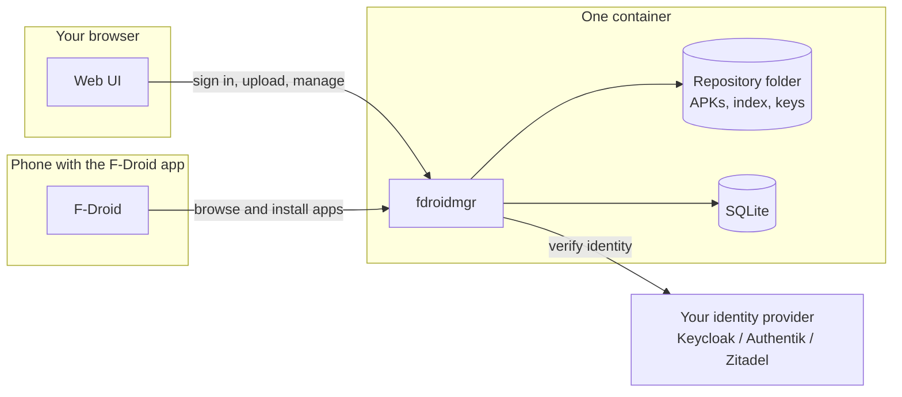

Everything runs in that one box: it serves the repository to phones *and* the
management UI, so there is no second web server to configure.

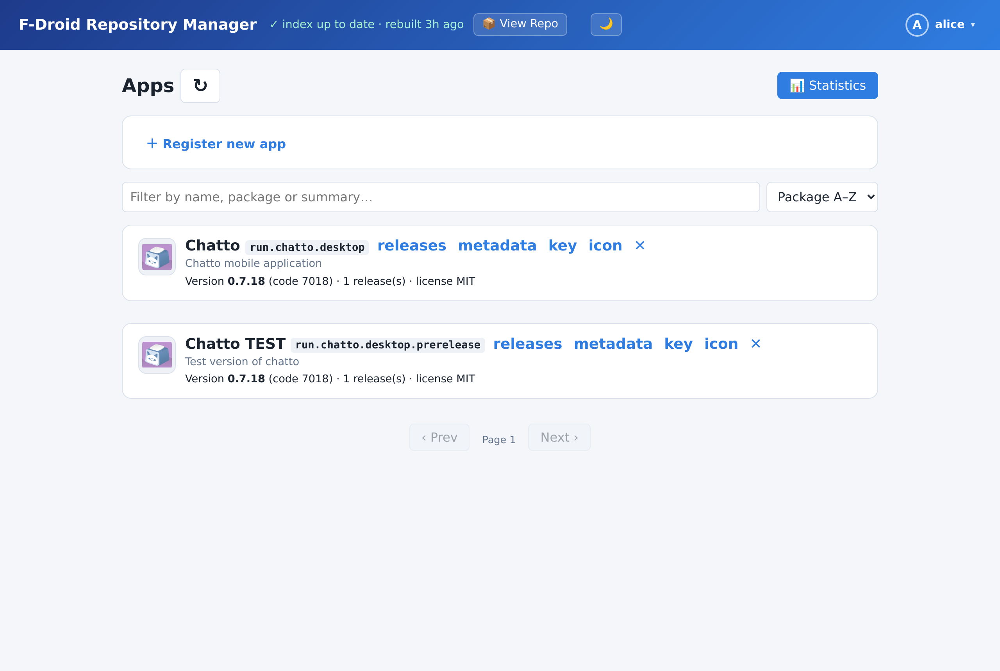

Light and dark themes, switched from the header.

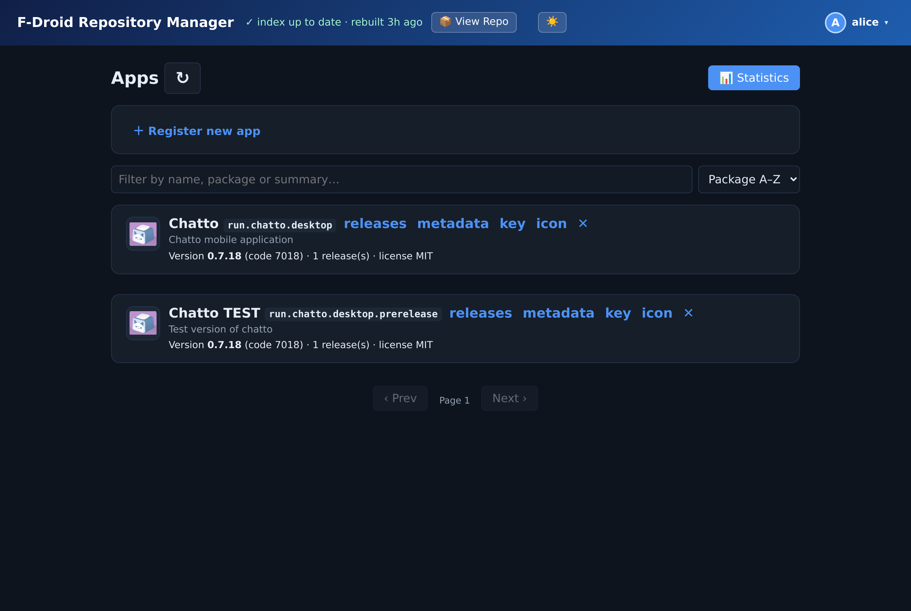

## What it does for you

| | |
|---|---|
| **No infrastructure** | one container; the repository is just a folder on disk |
| **Your own sign-on** | Keycloak, Authentik, Zitadel or any OIDC provider |
| **Keys handled for you** | a signing key per app, created on demand, encrypted at rest |
| **Works with the F-Droid app** | gives you a repo URL to paste into your phone |
| **See what people install** | per-app and per-release download statistics |

## Features

### App management

Register an app with its package name, license and description, upload its icon,
and edit its metadata later. Sort and filter the list by name, package or
summary; every view is linkable, so the back button walks through the app
instead of leaving it.

### Adding your first app

Open the web UI and register the app. Tick **Generate signing key automatically**
and a keystore is created for it — you do not have to run `keytool` yourself.

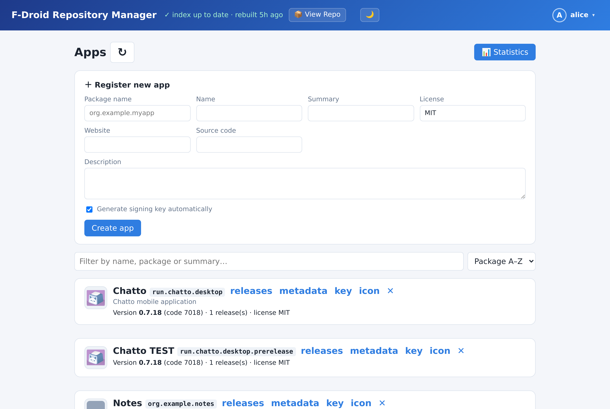

Then drop the APK on the **Releases** tab. You do not sign it yourself — the key
lives in the manager and never has to leave it:

- **Unsigned** — nothing signs it for you in your build, so it reaches the
  manager with no signature: the manager signs it with that app's key as it takes
  the upload. (A debug build is *not* unsigned; it carries the Android debug key
  and would be rejected as the wrong key.)
- **Already signed**: the signature must be the app's key, otherwise the upload is
  rejected. So a build pipeline can keep signing its own APKs, as long as it uses
  the same key — import an existing keystore when the app already has one.

Either way the `versionCode` has to be higher than what is already published, so a
downgrade can never slip through, and the index is regenerated for you.

You do not have to keep track of that number yourself: the form shows the next
version, and `GET /api/apps/{packageName}/releases/next-version` returns it for a
build pipeline to bake into the APK before it compiles.

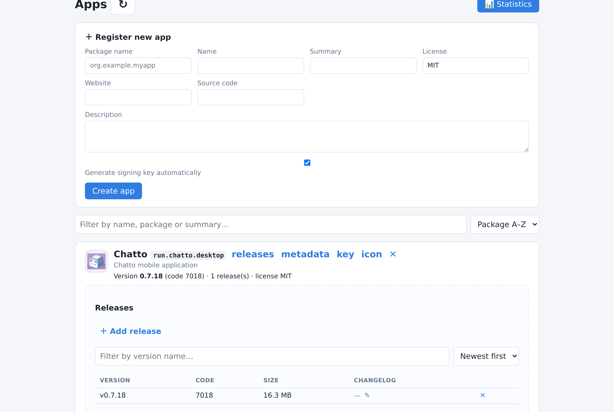

The app's metadata — the file F-Droid reads to describe it — is generated from
what you typed in, and you can edit it at any time.

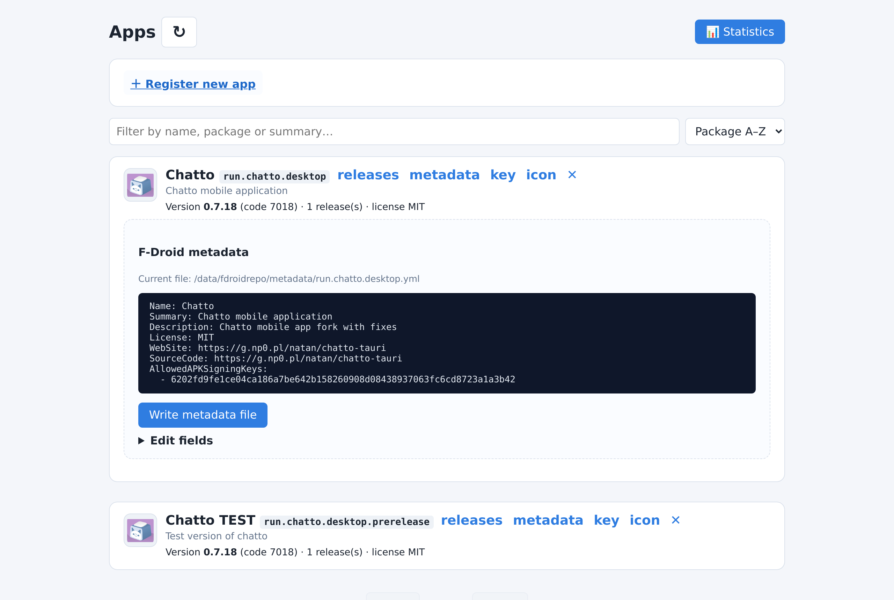

### Signing keys

Every app gets its own keystore, created inside the container and never served
over HTTP. Passwords are encrypted at rest with your master key and are only ever
decrypted at the moment of signing, so they are never written to disk in the
clear. If an app has several release lines (for example a stable and a testing
flavour), each can have its own key.

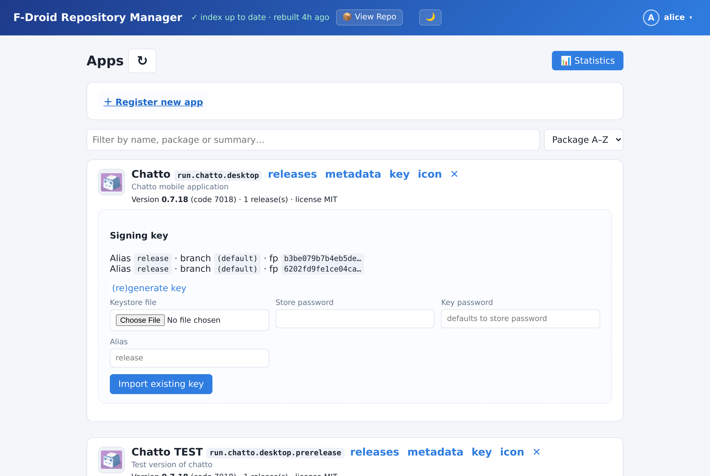

> ⚠️ Android requires *the same* key for every update of an app. Back up the
> keys and the master key — if you lose them, the app can never be updated
> again. See [Backup & restore](docs/backup-restore.md).

### Download statistics

See how often each app and each release was downloaded, with a chart of the last
thirty days. Useful for answering "does anyone actually use this?".

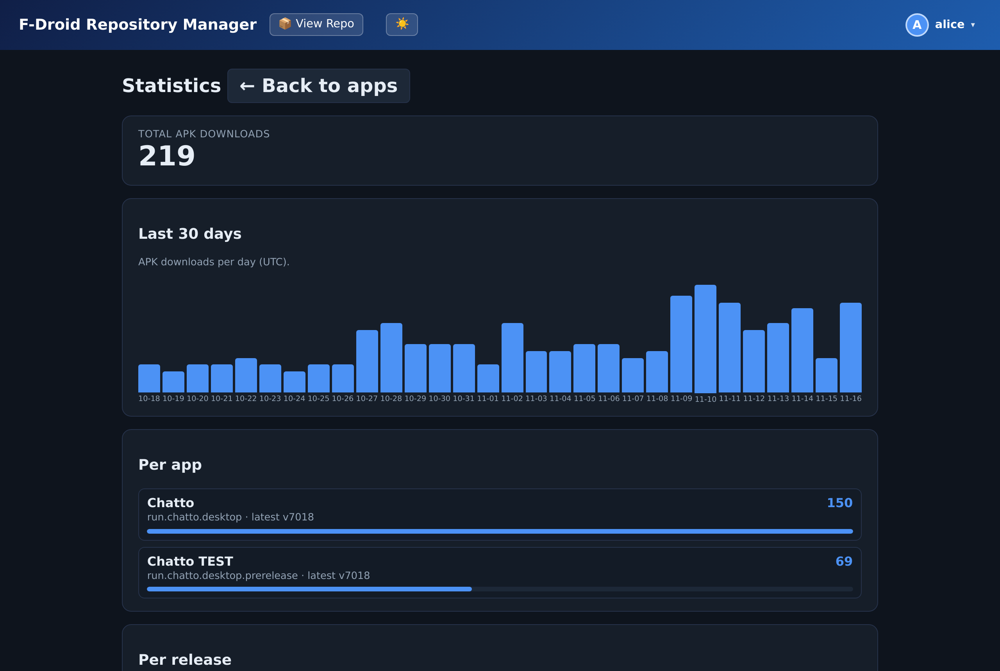

### Private sign-in (SSO)

Sign in with your own identity provider — Keycloak, Authentik, Zitadel or any
standard OIDC server. On first boot the app asks for your provider's address and
client id; the settings apply immediately, no restart.

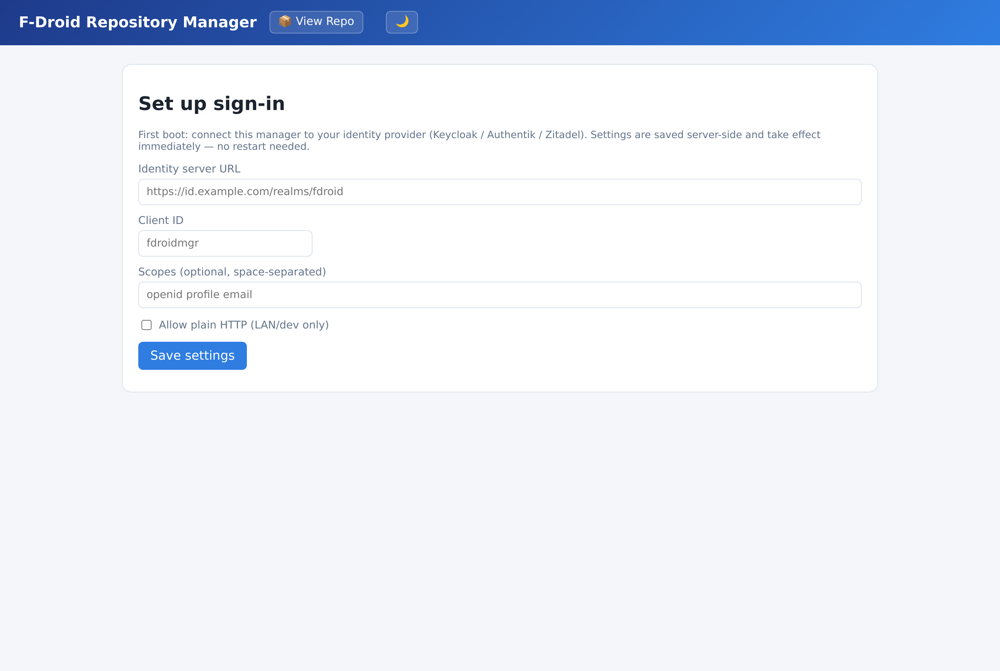

Once configured, anyone opening the page signs in through your IdP. The repository
is gated too: a phone cannot do a web login, so it authenticates with a per-user
client key that rides in the repo URL the UI hands you. If you would rather serve
the repository anonymously to anyone with the URL, set
`FDROID_REQUIRE_REPO_AUTH=false`.

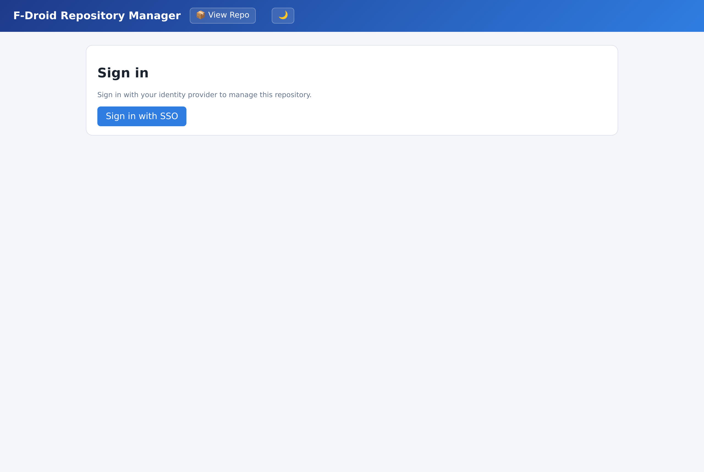

### Access from the F-Droid app

Each user gets a read-only URL for the F-Droid client on their phone. Add it
under **Settings → Repositories** in the app and your private apps appear
alongside the public ones.

### API keys for automation

Pipelines and scripts that need to publish apps get their own scoped key instead
of a human account, so a leaked CI secret cannot delete apps, and one key can be
revoked without logging anyone out.

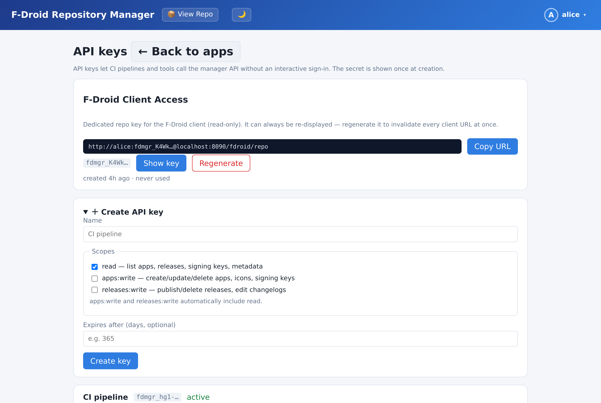

## Getting started

### With Docker / Podman

```bash
cp .env.example .env   # then set FDROID_MASTER_KEY (openssl rand -hex 32)
docker compose up -d
```

Open **http://localhost:8082/ui**, follow the sign-in setup, and you are running.

For the full walkthrough — HTTPS, reverse proxy, OIDC setup, taking over an
**existing** repository, backups — see
**[docs/deployment.md](docs/deployment.md)**.

### From source

You need the .NET 10 SDK. See **[docs/development.md](docs/development.md)**.

## Notes

- **Plain HTTP works, but is not enough.** The F-Droid client will install from an
  HTTP repository (with a warning), which is fine on a trusted home network. Put
  it behind HTTPS if anything at all is in between.
- **Everything you need is in the image.** No Android SDK or host toolchain to
  install; the container carries its own tools for inspecting and signing APKs.
- **Nothing leaves your machine.** Your APKs, your keys, your user accounts stay
  on your server. The app makes no outbound calls of its own — no telemetry, no
  callbacks, no update checks: the only network traffic is to the identity
  provider you point it at.
- **Losing the master key loses the apps.** Keep an offline backup of the keys and
  the master key. They are unrecoverable, and without them your apps cannot be
  updated on devices that already have them.

## Documentation

| | |
|---|---|
| **[Deployment guide](docs/deployment.md)** | install from scratch, HTTPS, reverse proxy, OIDC, adopting an existing repo |
| **[Backup & restore](docs/backup-restore.md)** | what to back up and how to restore it |
| **[Keycloak setup](docs/keycloak-setup.md)** | realm and client configuration for the sign-in wizard |
| **[API reference](docs/api.md)** | endpoint list, authentication, API keys, and querying |
| **[Contributing](docs/development.md)** | run it locally, project layout, tests, CI |

## License

[MIT](LICENSE)
